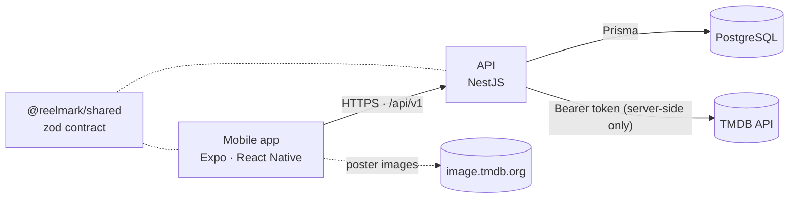

<p align="center">
  <picture>
    <source media="(prefers-color-scheme: dark)" srcset="docs/assets/logo.svg">
    
  </picture>
</p>

<p align="center">
  <b>Swipe through movies. Remember what you've seen. Find what to watch next.</b>
</p>

<p align="center">
  <a href="https://github.com/IvanProts/reelmark/actions/workflows/ci.yml"></a>
  
  
  
  
  
</p>

<p align="center"><a href="README.uk.md">Українська версія</a></p>

---

Reelmark is a mobile movie library you build by swiping. Movie fans who have watched hundreds of
films lose track of what they've already seen — and finding something new gets harder every time.
Reelmark shows one movie at a time: mark it as seen, not seen or want to watch, and the app
builds your personal library.

<p align="center">
  
  
  
  
</p>

## Features

- **Swipe to sort**: right = seen, left = not seen, up = want to watch, with a quick "liked it?"
  for seen movies and one-tap undo; buttons and screen-reader actions do the same
- **Personal library** of seen and want-to-watch movies; change or remove a decision anytime
- **Decide faster**: a movie card with the trailer (played in the app), Rotten Tomatoes and
  Metacritic scores, runtime, age rating, cast and where to watch in your country
- **No sign-up wall**: an anonymous account is created on first launch; decisions sync to the
  server and sorted movies never come back to the deck
- **Card deck** of popular movies with poster, year, rating, genres and overview
- **Ukrainian and English** for both the interface and movie data, following the device language
  and switchable in-app; missing translations fall back to English
- **Fast and resilient**: the next page is prefetched before you run out of cards; clear offline
  and error states with retry
- **Accessible**: WCAG AA contrast, screen-reader labels, Dynamic Type, Reduce Motion
- **Secure by design**: the app holds no secrets — see [Security](#security)

**Status:** swiping, accounts, the library and the decision card (Phases 1 and 1.5) are complete
— see the [roadmap](docs/ROADMAP.md).

## Tech stack

| Layer    | Technology                                                                          |
| -------- | ----------------------------------------------------------------------------------- |
| Mobile   | React Native 0.86 · Expo SDK 57 · Expo Router · TanStack Query · Reanimated         |
| API      | NestJS 12 (ESM) · Express · native `fetch` · JWT (`jose`)                           |
| Database | PostgreSQL 17 · Prisma 7                                                            |
| Contract | zod 4 schemas shared by the API and the app (`@reelmark/shared`)                    |
| Data     | [TMDB](https://www.themoviedb.org) API                                              |
| Tooling  | TypeScript 6 (strict) · pnpm 12 workspaces · Turborepo · oxlint · Prettier · Vitest |
| CI       | GitHub Actions: format, lint, typecheck, tests, dependency audit, secret scan       |

## Architecture



- The **API is the trust boundary**: it owns the TMDB token and is the only component that calls
  TMDB. Each endpoint maps to a fixed upstream call — there is no generic proxy.
- The **contract is shared**: the API validates requests and the app validates responses against
  the same zod schemas, so the two can't silently drift apart.
- **Upstream data is untrusted**: TMDB responses are size-capped, schema-validated and mapped to our
  own types; results are cached with in-flight de-duplication.

Details: [docs/ARCHITECTURE.md](docs/ARCHITECTURE.md).

## Security

- **No secrets on the device.** The app bundle contains only the API URL; the TMDB token never
  leaves the server and is sent only as a request header — never in URLs or logs.
- **Accounts done carefully.** Short-lived access tokens kept in memory; refresh tokens in the OS
  keychain, rotated on every use with reuse detection, and stored on the server only as hashes.
  Every query is scoped to the user from the verified token, and the tests try cross-user access.
- **Hardened API.** Security headers (helmet), per-user rate limiting, JSON-only bodies with a size
  cap, strict input validation, `no-store` responses, uniform errors without internals, fail-fast
  configuration validation.
- **Defensive upstream handling.** Timeouts, response size caps, no redirect following, per-item
  validation of third-party data.
- **Secrets stay out of git.** `.gitignore`, a pre-commit hook (blocks env files and scans staged
  changes with [gitleaks](https://github.com/gitleaks/gitleaks)) and a CI scan of the full history.
- **Supply chain.** pnpm blocks dependency install scripts, waits 24 h before installing new
  releases and fails on provenance downgrades; CI audits production dependencies; GitHub Actions
  are pinned to commit SHAs.

## Getting started

### Prerequisites

- Node.js 24 (see `.nvmrc`) and pnpm via Corepack: `corepack enable pnpm`
- [gitleaks](https://github.com/gitleaks/gitleaks) for the pre-commit hook: `brew install gitleaks`
- Docker for the local database ([OrbStack](https://orbstack.dev) or Docker Desktop)
- Xcode with an iOS Simulator and/or Android Studio with an emulator
- A free TMDB account and an **API Read Access Token**
  ([Settings → API](https://www.themoviedb.org/settings/api))

### Setup

```sh
pnpm install
pnpm setup:env   # creates the env files and generates local secrets (never printed)
pnpm db:up       # local PostgreSQL 17, bound to 127.0.0.1
pnpm db:migrate  # apply database migrations
```

Then paste your TMDB token into `apps/api/.env` (`TMDB_ACCESS_TOKEN`). The mobile app's API URL
for simulators, emulators and physical devices is set in `apps/mobile/.env`.

### Run

```sh
pnpm dev:api      # API on http://127.0.0.1:3000/api/v1
pnpm dev:mobile   # Expo dev server — press i for iOS, a for Android
```

### Run on a phone

With [Expo Go](https://expo.dev/go) on a phone connected to the same Wi-Fi as your computer:

```sh
pnpm dev:api:lan      # API on this Mac's Wi-Fi address, only while it runs
pnpm dev:mobile:lan   # in a second terminal; scan the QR code with the phone
```

Use this on a trusted network only. The database stays bound to 127.0.0.1.

## Scripts

| Command                  | Description                                                         |
| ------------------------ | ------------------------------------------------------------------- |
| `pnpm dev:api`           | Start the API in watch mode                                         |
| `pnpm dev:mobile`        | Start the Expo dev server                                           |
| `pnpm dev:*:lan`         | The same, reachable from a phone on the local network               |
| `pnpm db:up` / `db:down` | Start / stop the local PostgreSQL                                   |
| `pnpm db:migrate`        | Apply database migrations                                           |
| `pnpm check`             | Everything CI runs: format check, lint, typecheck, unit + e2e tests |
| `pnpm format`            | Format the repository with Prettier                                 |
| `pnpm security:secrets`  | Scan the working tree for secrets (gitleaks)                        |
| `pnpm security:audit`    | Audit production dependencies                                       |

## Testing

The API has unit tests for pure logic and end-to-end tests that run the real Nest application over
HTTP against a **real PostgreSQL test database** and a **fake TMDB server** — covering the contract,
sign-in and token rotation, cross-user isolation, adversarial input, rate limiting, caching,
upstream failures, and checks that tokens never appear in any log output. No test calls the real
TMDB API or reads your `.env`. The e2e tests need the local database running (`pnpm db:up`).

```sh
pnpm check
```

## Project structure

```
apps/
  api/          NestJS API — auth, decisions, library, catalog, TMDB client, Prisma schema
  mobile/       Expo app — routes (src/app), components, i18n, theme, data layer
packages/
  shared/       API contract: zod schemas + inferred types
docs/           Architecture, backlog, screenshots, brand assets
.github/        CI workflow
.githooks/      Pre-commit secret checks
```

## Attribution

This product uses the TMDB API but is not endorsed or certified by TMDB. Movie data and images are
provided by [The Movie Database (TMDB)](https://www.themoviedb.org).

## Author

**Ivan Prots** — [github.com/IvanProts](https://github.com/IvanProts)

## License

Copyright © 2026 Ivan Prots. All rights reserved. The source code is published for viewing and
evaluation only — see [LICENSE](LICENSE).
