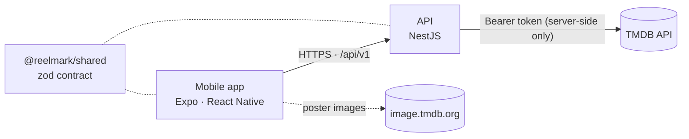

<p align="center">
  <picture>
    <source media="(prefers-color-scheme: dark)" srcset="docs/assets/logo.svg">
    
  </picture>
</p>

<p align="center">
  <b>Swipe through movies. Remember what you've seen. Find what to watch next.</b>
</p>

<p align="center">
  
  
  
  
  
</p>

<p align="center"><a href="README.uk.md">Українська версія</a></p>

---

Reelmark is a mobile movie library you build by swiping. Movie fans who have watched hundreds of
films lose track of what they've already seen — and finding something new gets harder every time.
Reelmark shows one movie at a time: mark it as seen or not, and the app builds your personal
library and, next, recommendations based on it.

<p align="center">
  
  
  
  
</p>

## Features

- **Card deck** of popular movies with poster, year, rating, genres and overview
- **Ukrainian and English** for both the interface and movie data, following the device language
  and switchable in-app; missing translations fall back to English
- **Fast and resilient**: the next page is prefetched before you run out of cards; clear offline
  and error states with retry
- **Accessible**: WCAG AA contrast, screen-reader labels, Dynamic Type, Reduce Motion
- **Secure by design**: the app holds no secrets — see [Security](#security)

**Status:** early development. The foundation (Phase 0) is complete; swipe gestures, accounts and a
persistent library (Phase 1) are next — see the [backlog](docs/BACKLOG.md).

## Tech stack

| Layer    | Technology                                                                          |
| -------- | ----------------------------------------------------------------------------------- |
| Mobile   | React Native 0.86 · Expo SDK 57 · Expo Router · TanStack Query · Reanimated         |
| API      | NestJS 12 (ESM) · Express · native `fetch`                                          |
| Contract | zod 4 schemas shared by the API and the app (`@reelmark/shared`)                    |
| Data     | [TMDB](https://www.themoviedb.org) API                                              |
| Tooling  | TypeScript 6 (strict) · pnpm 12 workspaces · Turborepo · oxlint · Prettier · Vitest |
| CI       | GitHub Actions: format, lint, typecheck, tests, dependency audit, secret scan       |

## Architecture



- The **API is the trust boundary**: it owns the TMDB token and is the only component that calls
  TMDB. Each endpoint maps to a fixed upstream call — there is no generic proxy.
- The **contract is shared**: the API validates requests and the app validates responses against
  the same zod schemas, so the two can't silently drift apart.
- **Upstream data is untrusted**: TMDB responses are size-capped, schema-validated and mapped to our
  own types; results are cached with in-flight de-duplication.

Details: [docs/ARCHITECTURE.md](docs/ARCHITECTURE.md).

## Security

- **No secrets on the device.** The app bundle contains only the API URL; the TMDB token never
  leaves the server and is sent only as a request header — never in URLs or logs.
- **Hardened API.** Security headers (helmet), per-client rate limiting, strict input validation,
  uniform error responses without internals, fail-fast configuration validation.
- **Defensive upstream handling.** Timeouts, response size caps, no redirect following, per-item
  validation of third-party data.
- **Secrets stay out of git.** `.gitignore`, a pre-commit hook (blocks env files and scans staged
  changes with [gitleaks](https://github.com/gitleaks/gitleaks)) and a CI scan of the full history.
- **Supply chain.** pnpm blocks dependency install scripts, waits 24 h before installing new
  releases and fails on provenance downgrades; CI audits production dependencies; GitHub Actions
  are pinned to commit SHAs.

## Getting started

### Prerequisites

- Node.js 24 (see `.nvmrc`) and pnpm via Corepack: `corepack enable pnpm`
- [gitleaks](https://github.com/gitleaks/gitleaks) for the pre-commit hook: `brew install gitleaks`
- Xcode with an iOS Simulator and/or Android Studio with an emulator
- A free TMDB account and an **API Read Access Token**
  ([Settings → API](https://www.themoviedb.org/settings/api))

### Setup

```sh
pnpm install
cp apps/api/.env.example apps/api/.env        # then set TMDB_ACCESS_TOKEN
cp apps/mobile/.env.example apps/mobile/.env  # API URL for simulator / emulator / device
```

### Run

```sh
pnpm dev:api      # API on http://127.0.0.1:3000/api/v1
pnpm dev:mobile   # Expo dev server — press i for iOS, a for Android
```

## Scripts

| Command                 | Description                                                         |
| ----------------------- | ------------------------------------------------------------------- |
| `pnpm dev:api`          | Start the API in watch mode                                         |
| `pnpm dev:mobile`       | Start the Expo dev server                                           |
| `pnpm check`            | Everything CI runs: format check, lint, typecheck, unit + e2e tests |
| `pnpm format`           | Format the repository with Prettier                                 |
| `pnpm security:secrets` | Scan the working tree for secrets (gitleaks)                        |
| `pnpm security:audit`   | Audit production dependencies                                       |

## Testing

The API has unit tests for pure logic and end-to-end tests that run the real Nest application over
HTTP against a **fake TMDB server** — covering the contract, adversarial input, rate limiting,
caching, upstream failures, and checks that the token never appears in any log output. No test
calls the real TMDB API or reads your `.env`.

```sh
pnpm check
```

## Project structure

```
apps/
  api/          NestJS API — config, TMDB client, movies module, security middleware
  mobile/       Expo app — routes (src/app), components, i18n, theme, data layer
packages/
  shared/       API contract: zod schemas + inferred types
docs/           Architecture, backlog, screenshots, brand assets
.github/        CI workflow
.githooks/      Pre-commit secret checks
```

## Attribution

This product uses the TMDB API but is not endorsed or certified by TMDB. Movie data and images are
provided by [The Movie Database (TMDB)](https://www.themoviedb.org).

## Author

**Ivan Prots** — [github.com/IvanProts](https://github.com/IvanProts)

## License

Copyright © 2026 Ivan Prots. All rights reserved. The source code is published for viewing and
evaluation only — see [LICENSE](LICENSE).
