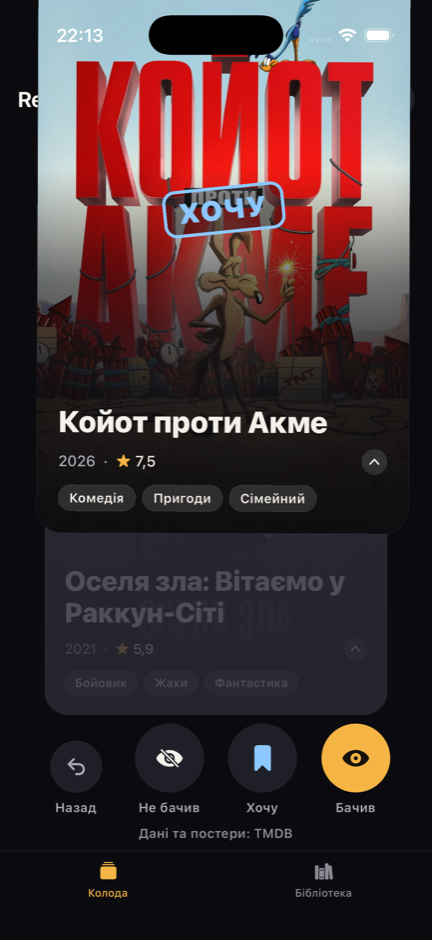
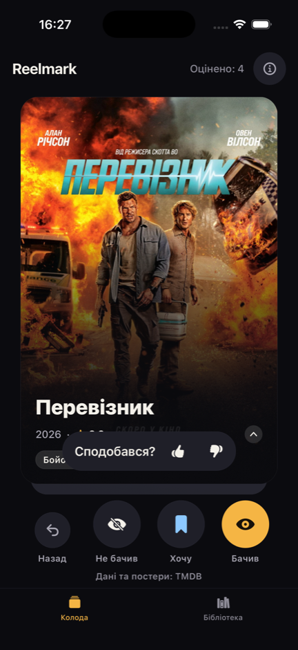
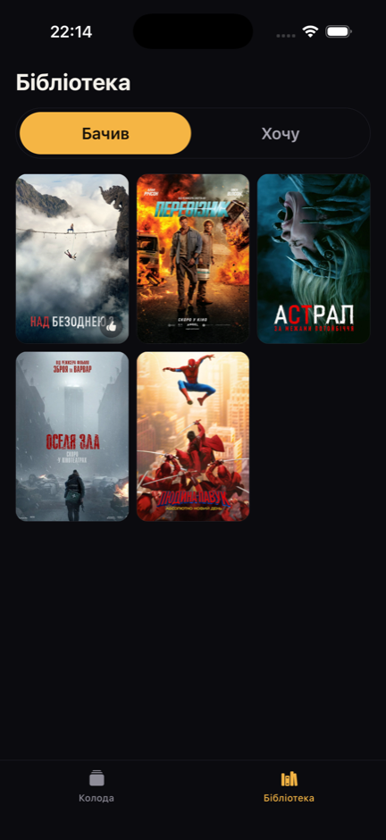
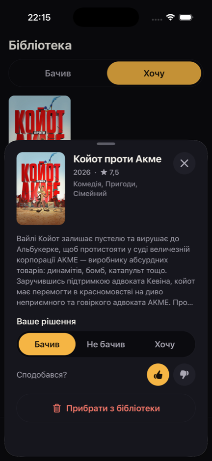
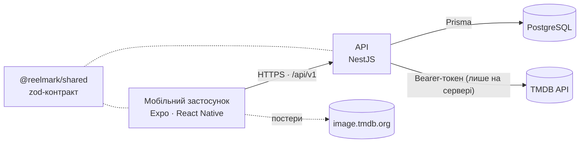

<p align="center">
  <picture>
    <source media="(prefers-color-scheme: dark)" srcset="docs/assets/logo.svg">
    
  </picture>
</p>

<p align="center">
  <b>Гортай фільми. Пам'ятай, що вже бачив. Знаходь, що подивитися далі.</b>
</p>

<p align="center"><a href="README.md">English version</a></p>

---

Reelmark — мобільна кінобібліотека, яку ти збираєш свайпами. Кіномани, що переглянули сотні
фільмів, губляться в тому, що вже бачили, а знайти щось нове стає дедалі важче. Reelmark показує
по одному фільму: познач, чи бачив його або хочеш подивитися, — і застосунок збирає твою
бібліотеку.

<p align="center">
  
  
  
  
</p>

## Можливості

- **Сортуй свайпами**: вправо — бачив, вліво — не бачив, угору — хочу подивитися; для
  переглянутих — швидке «Сподобався?», скасування одним дотиком; кнопки й VoiceOver роблять те саме
- **Особиста бібліотека** переглянутих і запланованих фільмів; рішення можна змінити чи прибрати
- **Без реєстрації**: анонімний акаунт створюється під час першого запуску; рішення зберігаються
  на сервері, а відсортовані фільми більше не з'являються в колоді
- **Колода карток** популярних фільмів: постер, рік, рейтинг, жанри, опис
- **Українська та англійська** — і інтерфейс, і дані про фільми; мова береться з налаштувань
  телефона й перемикається в застосунку; якщо перекладу опису немає — показується англійський
- **Швидко й надійно**: наступна сторінка підвантажується заздалегідь; зрозумілі стани помилок
  з повтором
- **Доступність**: контраст WCAG AA, підписи для VoiceOver/TalkBack, великий шрифт, зменшений рух
- **Безпека за задумом**: у застосунку немає жодних секретів — див. [Безпека](#безпека)

**Статус:** рання розробка. Свайпи, акаунти й бібліотека (етап 1) готові; далі — картка
рішення з трейлером і оцінками критиків (етап 1.5), див. [роадмап](docs/ROADMAP.md).

## Архітектура



- **API — межа довіри**: лише він знає токен TMDB і лише він звертається до TMDB. Кожен ендпоінт
  відповідає фіксованому запиту — жодного «універсального проксі».
- **Спільний контракт**: API перевіряє запити, а застосунок — відповіді за тими самими zod-схемами,
  тож вони не можуть непомітно розійтися.
- **Дані TMDB — недовірені**: розмір обмежений, структура перевіряється, дані перетворюються на наші
  власні типи; результати кешуються.

Детально: [docs/ARCHITECTURE.md](docs/ARCHITECTURE.md) (англ.). Як читати код:
[docs/CODE_TOUR.uk.md](docs/CODE_TOUR.uk.md).

## Безпека

- **Жодних секретів на пристрої.** У застосунку є лише адреса API; токен TMDB не залишає сервер і
  передається тільки в заголовку — ніколи в URL чи логах.
- **Акаунти зроблені обережно.** Короткоживучий access-токен лише в пам'яті; refresh-токен у
  сховищі ключів ОС, змінюється при кожному використанні з виявленням повторного використання, а на
  сервері зберігається лише його хеш. Кожен запит до бази обмежений користувачем із перевіреного
  токена, а тести пробують дістатися до чужих даних.
- **Захищений API.** Безпекові заголовки (helmet), обмеження частоти запитів на користувача, лише
  JSON з обмеженням розміру, сувора валідація вхідних даних, заборона кешування відповідей, однакові
  відповіді на помилки без внутрішніх деталей, перевірка конфігурації при старті.
- **Обережна робота з TMDB.** Тайм-аути, ліміт розміру відповіді, заборона редиректів, перевірка
  кожного фільму окремо.
- **Секрети не потрапляють у git.** `.gitignore`, хук перед комітом (блокує env-файли, сканує зміни
  [gitleaks](https://github.com/gitleaks/gitleaks)) і сканування всієї історії в CI.
- **Ланцюжок постачання.** pnpm блокує install-скрипти залежностей, не ставить релізи, молодші за
  24 год, і зупиняється на підозрілих змінах у публікації пакетів; CI перевіряє залежності на
  вразливості; GitHub Actions закріплені за конкретними комітами.

## Запуск

Потрібно: Node.js 24, pnpm (`corepack enable pnpm`), gitleaks (`brew install gitleaks`), Docker
([OrbStack](https://orbstack.dev) або Docker Desktop), Xcode та/або Android Studio, безкоштовний токен TMDB (**API Read Access Token**,
[Settings → API](https://www.themoviedb.org/settings/api)).

```sh
pnpm install
pnpm setup:env    # створює env-файли й генерує локальні секрети (не показуючи їх)
pnpm db:up        # локальний PostgreSQL 17 (Docker / OrbStack)
pnpm db:migrate   # застосовує міграції бази даних
# далі встав токен TMDB у apps/api/.env (TMDB_ACCESS_TOKEN)
pnpm dev:api      # API на http://127.0.0.1:3000/api/v1
pnpm dev:mobile   # Expo — i для iOS, a для Android
```

**На телефоні** (Expo Go, телефон і Mac в одній Wi-Fi; лише в довіреній мережі):

```sh
pnpm dev:api:lan      # API на Wi-Fi-адресі Mac, лише поки команда працює
pnpm dev:mobile:lan   # у другому терміналі; відскануй QR-код телефоном
```

`pnpm check` — усе, що запускає CI: форматування, лінтер, типи, юніт- та e2e-тести.

## Атрибуція

This product uses the TMDB API but is not endorsed or certified by TMDB. Дані про фільми та
зображення надає [The Movie Database (TMDB)](https://www.themoviedb.org).

## Автор

**Ivan Prots** — [github.com/IvanProts](https://github.com/IvanProts)

## Ліцензія

Copyright © 2026 Ivan Prots. Усі права захищено. Код опубліковано лише для перегляду й оцінки —
див. [LICENSE](LICENSE).
