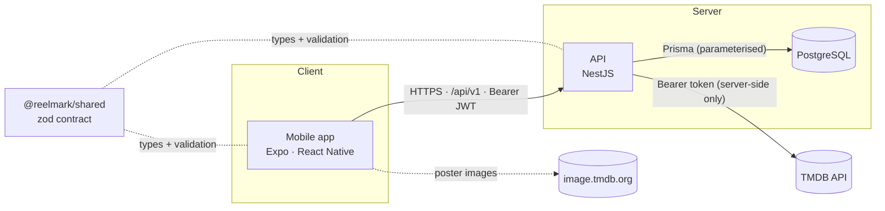
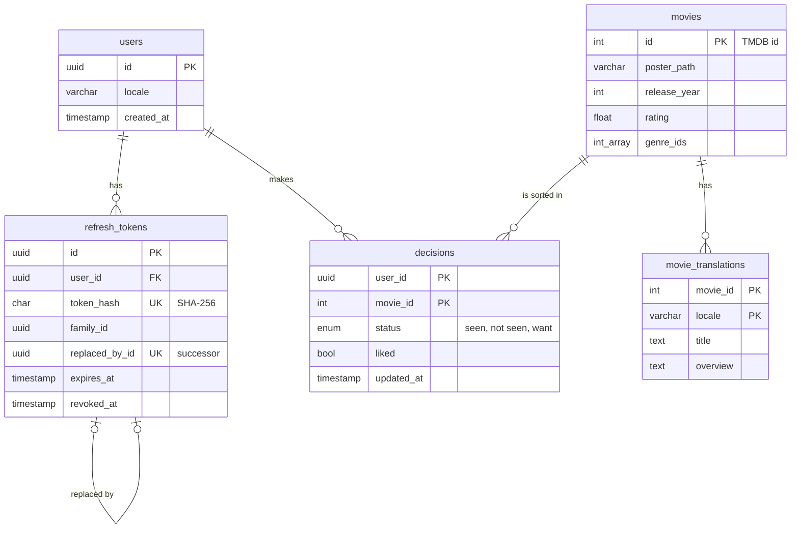

# Architecture

This document describes how Reelmark is put together and why. For setup instructions see the
[README](../README.md).

## System overview



Three workspaces in one pnpm + Turborepo monorepo:

| Workspace         | Role                                                                                     |
| ----------------- | ---------------------------------------------------------------------------------------- |
| `apps/api`        | NestJS 12 REST API. The trust boundary: owns every secret, the database and TMDB calls.  |
| `apps/mobile`     | Expo SDK 57 app for iOS and Android. Holds no secrets; talks only to our API.            |
| `packages/shared` | The API contract as zod schemas. Both sides validate against it and infer types from it. |

### Guiding principles

1. **The API is the trust boundary.** The app bundle is public: anyone can unpack it. So the TMDB
   token lives only on the server, and the app never calls TMDB directly (it only loads poster
   images from TMDB's public CDN using URLs the API returns).
2. **Contract-first.** Request and response shapes are defined once in `packages/shared`. The API
   validates incoming requests with them; the app validates incoming responses with them. A change
   to the contract fails to compile on whichever side wasn't updated.
3. **Third-party data is untrusted input.** TMDB responses are size-capped, parsed with zod and
   mapped to our own types. Raw upstream data never reaches the app or the database.
4. **Identity comes only from the verified token.** Handlers get the user id from the access
   token (`@CurrentUser()`), never from a path, query or body, so one user can't address another
   user's data.
5. **Fail closed, fail quietly.** Invalid configuration stops the boot; errors reach clients as a
   uniform `{ statusCode, message }` with no internals; details go to server logs only.

## Request lifecycle

`GET /api/v1/movies/deck?page=2&lang=uk`

```mermaid
sequenceDiagram
    autonumber
    participant App as Mobile app
    participant MW as Middleware
    participant AG as AuthGuard
    participant TG as UserThrottlerGuard
    participant VP as Validation pipe
    participant MS as MoviesService
    participant TC as TmdbClient
    participant DB as PostgreSQL

    App->>MW: GET /api/v1/movies/deck?page=2&lang=uk + Bearer JWT
    MW->>AG: helmet headers, Cache-Control: no-store, JSON-only bodies
    AG->>TG: JWT verified (HS256, issuer, audience, expiry); user still exists
    TG->>VP: within 60 req/min for this user
    VP->>MS: { page: 2, lang: "uk" } (DeckQuerySchema)
    MS->>TC: discoverMovies(2, uk) + getMovieGenres(uk)
    TC-->>MS: validated movies + genre names (cached)
    opt some uk overviews are empty
        MS->>TC: discoverMovies(2, en)
    end
    MS->>DB: upsert served movies into the catalog
    MS->>DB: which of these has the user already sorted?
    MS-->>App: DeckResponse without sorted movies
```

Any exception on the way is converted by `AllExceptionsFilter` into the shared error shape. 4xx
messages are only shown when they are explicitly safe (`PublicHttpException`); everything else
gets the standard status text, so user input is never echoed back.

## API (`apps/api`)

| Module      | Responsibility                                                                              |
| ----------- | ------------------------------------------------------------------------------------------- |
| `config`    | Validates environment variables at boot (zod). Error messages name variables, never values. |
| `common`    | Exception filter, validation pipe, `AsyncCache`, per-user `UserThrottlerGuard`.             |
| `prisma`    | `PrismaService`: Prisma 7 over the `pg` driver adapter; connects at boot.                   |
| `auth`      | Anonymous sign-in, token issuing and rotation, the global `AuthGuard`, `@Public()`.         |
| `me`        | The caller's profile: read, change language, delete the account.                            |
| `decisions` | Save or undo the caller's decision on a movie.                                              |
| `library`   | The caller's seen / want-to-watch lists, keyset-paginated, served from the catalog.         |
| `catalog`   | Stores movies the API has served (validated TMDB data only), so decisions can reference it. |
| `tmdb`      | `TmdbClient` — the only code that talks to TMDB. Fixed, typed methods; no generic proxy.    |
| `movies`    | `/movies/deck`: orchestration (`MoviesService`) and pure TMDB → `MovieCard` mapping.        |
| `health`    | `/health` for uptime checks (public, not rate-limited).                                     |

### Endpoints

All routes live under `/api/v1` and require `Authorization: Bearer <access token>` unless marked
public.

| Route                           | Purpose                                                        |
| ------------------------------- | -------------------------------------------------------------- |
| `POST /auth/anonymous`          | Public. Creates an anonymous account; returns a token pair.    |
| `POST /auth/refresh`            | Public. Rotates a refresh token; returns a new pair.           |
| `GET /movies/deck`              | A page of swipe cards, without movies the user already sorted. |
| `GET /me` · `PATCH /me`         | Profile; `PATCH` saves the app language.                       |
| `DELETE /me`                    | Deletes the account, its tokens and decisions.                 |
| `PUT /me/decisions/:movieId`    | Saves seen / not seen / want (and "liked" for seen).           |
| `DELETE /me/decisions/:movieId` | Undo.                                                          |
| `GET /me/library`               | Seen or want-to-watch movies, newest first, cursor-paginated.  |
| `GET /health`                   | Public. Liveness.                                              |

### Accounts and sessions

Phase 1 accounts are anonymous: the first launch calls `POST /auth/anonymous`, with no sign-up
wall. Sign in with Apple / Google will later attach an identity to the same account.

| Token   | Format and lifetime                                    | Where the app keeps it                    | Where the API keeps it |
| ------- | ------------------------------------------------------ | ----------------------------------------- | ---------------------- |
| Access  | JWT, HS256, 15 min; `iss`, `aud`, `typ` pinned         | Memory only                               | Nowhere (stateless)    |
| Refresh | 256 random bits, base64url; 60 days, rotated every use | Keychain / Keystore (`expo-secure-store`) | SHA-256 hash only      |

- **Rotation with reuse detection.** Every refresh revokes the presented token and issues a
  successor in the same family. Presenting a token whose successor has already been used means
  someone else holds a copy: the whole family is revoked and every device on it must sign in again.
- **Deferred commit.** A rotated token stays redeemable until its successor is first used, so a
  refresh response lost to a killed app or a dropped connection doesn't lose an anonymous account.
  Refreshes of one account run one at a time (a row lock on the user), so concurrent ones can't
  conflict or fork the family.
- **Immediate revocation.** `AuthGuard` checks that the user still exists on every request, so a
  deleted account loses access at once, not when its last access token expires.
- **One failure, one answer.** Missing, forged, expired and revoked credentials all get the same
  401 body.

### Data model



- A decision is one row per `(user, movie)`, so saving is an upsert and undo is a delete. Saving
  the same decision again writes nothing, so a retried request doesn't reorder the library.
- The library is paginated by keyset `(updated_at, movie_id)` with an opaque cursor: stable while
  decisions are added or removed between pages, unlike offsets.
- Deleting a user cascades to their tokens and decisions. Movies are shared and never deleted while
  a decision references them.
- Migrations live in `apps/api/prisma/migrations` and are applied with `prisma migrate deploy`. The
  Prisma Client is generated from the schema (`pnpm db:generate`, a Turborepo dependency of every
  API task) and not committed.

### Upstream calls and caching

| What                | Policy                                                                     |
| ------------------- | -------------------------------------------------------------------------- |
| Discover pages      | Cached 10 min per `(locale, page)`, max 200 entries, successes only.       |
| Genre lists         | Cached 24 h per locale; a failure is cached for 60 s, then retried.        |
| Concurrent requests | Identical in-flight requests share a single upstream call.                 |
| Timeouts / size     | `TMDB_TIMEOUT_MS` (default 5 s) per call; responses capped at 2 MB.        |
| Redirects           | Never followed, so the token can only ever reach `TMDB_BASE_URL`.          |
| Partial data        | Invalid movies are dropped individually; a page fails only if all are bad. |
| Missing genres      | The deck is still served, cards just have no genre names.                  |

The library is served from the catalog, so it makes no per-movie TMDB calls.

### Rate limits

Counted per route and per caller: the user id on authenticated routes, the client IP otherwise.

| Route                    | Limit              |
| ------------------------ | ------------------ |
| Default                  | 60 / min per user  |
| `/me/decisions/:movieId` | 180 / min per user |
| `POST /auth/anonymous`   | 10 / hour per IP   |
| `POST /auth/refresh`     | 10 / min per IP    |
| `/health`                | Not limited        |

All caches and rate-limit counters are in-process. Running several API instances would require a
shared store (e.g. Redis) — not needed at the current scale.

## Mobile app (`apps/mobile`)

| Area        | Approach                                                                                                                                                                                                                                                                                     |
| ----------- | -------------------------------------------------------------------------------------------------------------------------------------------------------------------------------------------------------------------------------------------------------------------------------------------- |
| Navigation  | Expo Router (file-based routes in `src/app/`): tabs Deck and Library, a movie detail sheet, About. Unknown deep links redirect to the deck.                                                                                                                                                  |
| Swiping     | Reanimated + Gesture Handler: right = seen, left = not seen, up = want; buttons and screen-reader actions do the same. Saves are optimistic with retries; undo restores the card and deletes the decision.                                                                                   |
| Server data | TanStack Query: infinite deck query per language (the server excludes sorted movies, so the deck always starts at the first undecided one); library pages by cursor.                                                                                                                         |
| Session     | `src/lib/session.ts`: anonymous sign-in on first launch; refresh token in `expo-secure-store` (this device only, readable while unlocked); access token in memory; one shared refresh for concurrent 401s. Only a definite 401 on refresh starts a new account — a network error never does. |
| Networking  | `src/lib/http.ts`: 10 s timeout, response validated against the shared contract, typed errors (`unreachable`, `unauthorized`, `server`, `invalid-response`, `config`); error bodies never read or logged; HTTPS required in release builds.                                                  |
| i18n        | Typed dictionaries (`uk.ts` is the source of truth; `en.ts` must have the same keys); device language by default; the in-app choice is saved to the account (`PATCH /me`).                                                                                                                   |
| UI          | Design tokens in `src/theme/` (colours, spacing, typography); dark, poster-first layout; WCAG AA contrast; Dynamic Type and Reduce Motion respected.                                                                                                                                         |

## Security model

| Threat                                 | Mitigation                                                                                                        |
| -------------------------------------- | ----------------------------------------------------------------------------------------------------------------- |
| Token extracted from the app bundle    | No secrets in the app; only `EXPO_PUBLIC_API_URL` is inlined.                                                     |
| Token leaked via logs or URLs          | Sent only as a header; never logged; boot errors omit values.                                                     |
| Secret committed to git                | `.gitignore` + pre-commit hook (blocks env files, runs gitleaks) + CI scan of full history.                       |
| Our API abused as a free TMDB proxy    | Fixed endpoints only, validated parameters, authentication, per-user rate limit, caching.                         |
| Malicious or broken upstream data      | Size cap, zod parsing, strict poster-path and URL rules, mapping to own types.                                    |
| Information disclosure in errors       | Uniform error body; no stack traces, upstream bodies or echoed input.                                             |
| Access to another user's data (IDOR)   | User id only from the verified token; every query is scoped to it; tests try cross-user access.                   |
| Forged or tampered access token        | Algorithm, issuer, audience and type pinned; 64+ character secret validated at boot.                              |
| Stolen refresh token                   | Kept in the OS keychain; rotated on every use; reuse revokes the family; stored server-side as a hash only.       |
| Database leak                          | No usable tokens in it (hashes only); no personal data in anonymous accounts.                                     |
| Responses cached by proxies            | `Cache-Control: no-store` on every response.                                                                      |
| Oversized or unexpected request bodies | JSON only (other types get 415), 16 KB cap (413); form and multipart parsers never run.                           |
| Account farming                        | Anonymous sign-up limited to 10 per hour per IP.                                                                  |
| Database exposed on the network        | Local PostgreSQL bound to 127.0.0.1; generated password; all queries parameterised by Prisma.                     |
| Compromised npm package                | pnpm blocks install scripts, delays new releases by 24 h, fails on provenance downgrades; lockfile + audit in CI. |
| Secrets read by AI coding tools        | Deny rules and a pre-tool hook block reading `.env` files (`.claude/`).                                           |

## Testing strategy

| Suite                          | Scope                                                                                                                                                                                                                                                                                                                           |
| ------------------------------ | ------------------------------------------------------------------------------------------------------------------------------------------------------------------------------------------------------------------------------------------------------------------------------------------------------------------------------- |
| API unit (`*.spec.ts`)         | Pure logic: env schema, mappers, cache, cursor codec, token service, `TmdbClient` with a mocked `fetch`.                                                                                                                                                                                                                        |
| API e2e (`test/*.e2e-spec.ts`) | The real Nest app over HTTP against a real PostgreSQL test database (`reelmark_test`, migrated before the run), plus the real `TmdbClient` against a fake TMDB server: contract, auth and token rotation, cross-user isolation, adversarial input, rate limiting, caching, secret-leak checks on all log output, boot failures. |
| Mobile                         | Type-checked against the shared contract; lint with React hooks and a11y rules.                                                                                                                                                                                                                                                 |

No test calls the real TMDB API, and tests never read the developer's `.env`. The e2e suites run
one at a time because they reset the shared test database.

## Key decisions

| Decision                           | Why                                                                                                                      |
| ---------------------------------- | ------------------------------------------------------------------------------------------------------------------------ |
| pnpm + Turborepo monorepo          | One contract shared by API and app; task caching; pnpm's supply-chain controls.                                          |
| NestJS 12 (ESM)                    | Modular structure, DI and testing utilities; Standard Schema validation with zod.                                        |
| zod for every boundary             | One library for env, HTTP input, upstream responses and the shared contract.                                             |
| Native `fetch`, no HTTP client lib | Fewer dependencies; full control over timeouts, redirects and body size.                                                 |
| PostgreSQL + Prisma 7              | Relational data with real constraints; typed queries, versioned migrations; `pg` driver adapter, no binary query engine. |
| `jose` for JWTs                    | Small, dependency-free, standards-focused; explicit algorithm and claim checks.                                          |
| Anonymous accounts first           | No sign-up wall before the user sees value; Apple / Google sign-in attaches to the same account later.                   |
| Expo (managed) + Expo Router       | One codebase for iOS and Android; no native folders to maintain.                                                         |
| oxlint                             | Fast, zero-config type-aware linting; avoids `expo lint` installing packages implicitly.                                 |
| `nodeLinker: hoisted`              | Expo's recommendation for monorepos: guarantees a single copy of React Native.                                           |
