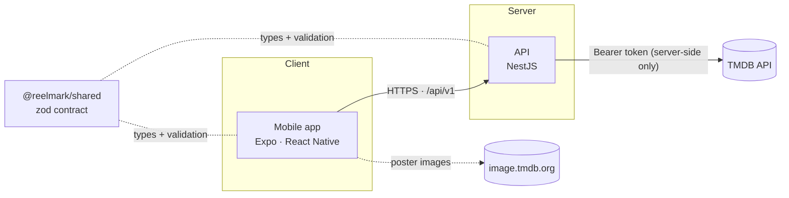
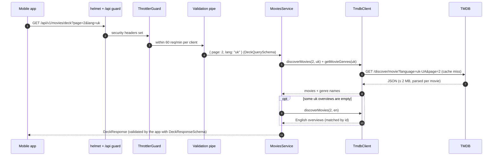

# Architecture

This document describes how Reelmark is put together and why. For setup instructions see the
[README](../README.md).

## System overview

Three workspaces in one pnpm + Turborepo monorepo:

| Workspace         | Role                                                                                     |
| ----------------- | ---------------------------------------------------------------------------------------- |
| `apps/api`        | NestJS 12 REST API. The trust boundary: owns every secret and every call to TMDB.        |
| `apps/mobile`     | Expo SDK 57 app for iOS and Android. Holds no secrets; talks only to our API.            |
| `packages/shared` | The API contract as zod schemas. Both sides validate against it and infer types from it. |

### Guiding principles

1. **The API is the trust boundary.** The app bundle is public: anyone can unpack it. So the TMDB
   token lives only on the server, and the app never calls TMDB directly (it only loads poster
   images from TMDB's public CDN using URLs the API returns).
2. **Contract-first.** Request and response shapes are defined once in `packages/shared`. The API
   validates incoming queries with them; the app validates incoming responses with them. A change
   to the contract fails to compile on whichever side wasn't updated.
3. **Third-party data is untrusted input.** TMDB responses are size-capped, parsed with zod and
   mapped to our own types. Raw upstream data never reaches the app.
4. **Fail closed, fail quietly.** Invalid configuration stops the boot; errors reach clients as a
   uniform `{ statusCode, message }` with no internals; details go to server logs only.

## Request lifecycle

`GET /api/v1/movies/deck?page=2&lang=uk`

Any exception on the way is converted by `AllExceptionsFilter` into the shared error shape. 4xx
messages are only shown when they are explicitly safe (`PublicHttpException`); everything else
gets the standard status text, so user input is never echoed back.

## API (`apps/api`)

| Module   | Responsibility                                                                              |
| -------- | ------------------------------------------------------------------------------------------- |
| `config` | Validates environment variables at boot (zod). Error messages name variables, never values. |
| `common` | Global exception filter, validation pipe, `AsyncCache` (TTL + in-flight de-duplication).    |
| `tmdb`   | `TmdbClient` — the only code that talks to TMDB. Fixed, typed methods; no generic proxy.    |
| `movies` | `/movies/deck`: orchestration (`MoviesService`) and pure TMDB → `MovieCard` mapping.        |
| `health` | `/health` for uptime checks (not rate-limited).                                             |

### Upstream calls and caching

| What                | Policy                                                                     |
| ------------------- | -------------------------------------------------------------------------- |
| Discover pages      | Cached 10 min per `(locale, page)`, max 200 entries, successes only.       |
| Genre lists         | Cached 24 h per locale; a failure is cached for 60 s, then retried.        |
| Concurrent requests | Identical in-flight requests share a single upstream call.                 |
| Timeouts / size     | `TMDB_TIMEOUT_MS` (default 5 s) per call; responses capped at 2 MB.        |
| Redirects           | Never followed, so the token can only ever reach `TMDB_BASE_URL`.          |
| Partial data        | Invalid movies are dropped individually; a page fails only if all are bad. |
| Missing genres      | The deck is still served, cards just have no genre names.                  |

All caches and the rate limiter are in-process. Running several API instances would require a
shared store (e.g. Redis) — not needed at the current scale.

## Mobile app (`apps/mobile`)

| Area        | Approach                                                                                                                                                                                |
| ----------- | --------------------------------------------------------------------------------------------------------------------------------------------------------------------------------------- |
| Navigation  | Expo Router (file-based routes in `src/app/`). Unknown deep links redirect to the deck.                                                                                                 |
| Server data | TanStack Query: infinite query per language; next page prefetched when ≤ 5 cards remain; one retry for network/5xx errors.                                                              |
| Networking  | `src/lib/api.ts`: 10 s timeout, response validated against the shared contract, typed errors (`unreachable`, `server`, `invalid-response`, `config`); HTTPS required in release builds. |
| i18n        | Typed dictionaries (`uk.ts` is the source of truth; `en.ts` must have the same keys); device language via `expo-localization`, switchable in-app.                                       |
| UI          | Design tokens in `src/theme/` (colours, spacing, typography); dark, poster-first layout; WCAG AA contrast; Dynamic Type and Reduce Motion respected.                                    |

## Security model

| Threat                              | Mitigation                                                                                                        |
| ----------------------------------- | ----------------------------------------------------------------------------------------------------------------- |
| Token extracted from the app bundle | No secrets in the app; only `EXPO_PUBLIC_API_URL` is inlined.                                                     |
| Token leaked via logs or URLs       | Sent only as a header; never logged; boot errors omit values.                                                     |
| Secret committed to git             | `.gitignore` + pre-commit hook (blocks env files, runs gitleaks) + CI scan of full history.                       |
| Our API abused as a free TMDB proxy | Fixed endpoints only, validated parameters, per-client rate limit, caching.                                       |
| Malicious or broken upstream data   | Size cap, zod parsing, strict poster-path and URL rules, mapping to own types.                                    |
| Information disclosure in errors    | Uniform error body; no stack traces, upstream bodies or echoed input.                                             |
| Compromised npm package             | pnpm blocks install scripts, delays new releases by 24 h, fails on provenance downgrades; lockfile + audit in CI. |
| Secrets read by AI coding tools     | Deny rules and a pre-tool hook block reading `.env` files (`.claude/`).                                           |

## Testing strategy

| Suite                          | Scope                                                                                                                                                                                         |
| ------------------------------ | --------------------------------------------------------------------------------------------------------------------------------------------------------------------------------------------- |
| API unit (`*.spec.ts`)         | Pure logic: env schema, mapper, cache, `TmdbClient` with a mocked `fetch`.                                                                                                                    |
| API e2e (`test/*.e2e-spec.ts`) | The real Nest app over HTTP, plus the real `TmdbClient` against a fake TMDB server: contract, adversarial input, rate limiting, caching, secret-leak checks on all log output, boot failures. |
| Mobile                         | Type-checked against the shared contract; lint with React hooks and a11y rules.                                                                                                               |

No test calls the real TMDB API, and tests never read the developer's `.env`.

## Key decisions

| Decision                           | Why                                                                                      |
| ---------------------------------- | ---------------------------------------------------------------------------------------- |
| pnpm + Turborepo monorepo          | One contract shared by API and app; task caching; pnpm's supply-chain controls.          |
| NestJS 12 (ESM)                    | Modular structure, DI and testing utilities; Standard Schema validation with zod.        |
| zod for every boundary             | One library for env, HTTP input, upstream responses and the shared contract.             |
| Native `fetch`, no HTTP client lib | Fewer dependencies; full control over timeouts, redirects and body size.                 |
| Expo (managed) + Expo Router       | One codebase for iOS and Android; no native folders to maintain.                         |
| oxlint                             | Fast, zero-config type-aware linting; avoids `expo lint` installing packages implicitly. |
| `nodeLinker: hoisted`              | Expo's recommendation for monorepos: guarantees a single copy of React Native.           |
