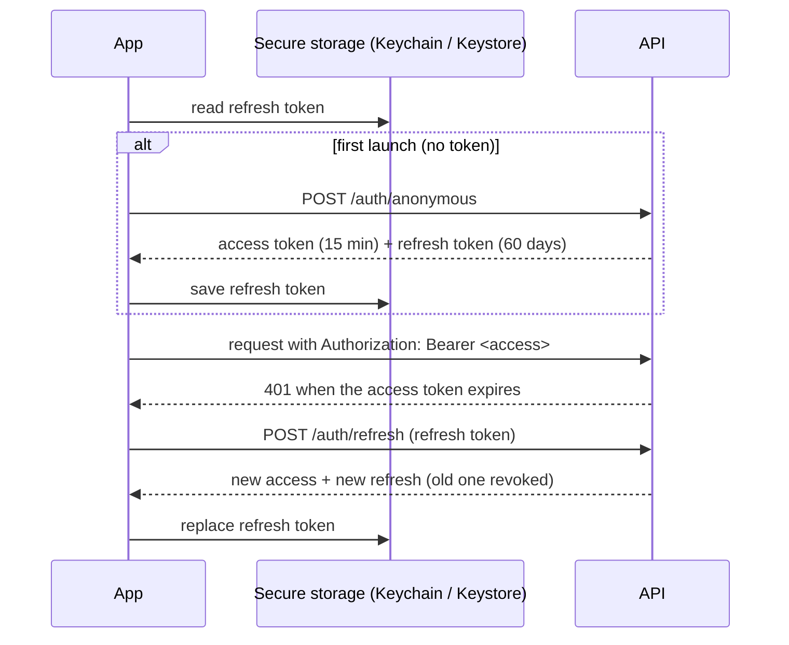

# Phase 1 design — swipes, accounts, library

Status: **proposed**. Roadmap: [../ROADMAP.md](../ROADMAP.md).

## Goals

- Sorting movies by swiping, fast enough to get through hundreds of cards in a session.
- Every decision is saved to the user's account, and the deck never shows a movie twice.
- A library of seen and want-to-watch movies in the user's language.
- No sign-up wall: the first card appears right after install.

**Non-goals:** sign in with Apple/Google and cross-device sync (Phase 1b), recommendations
(Phase 2), push notifications (Phase 3), offline mode beyond request retries.

## User experience

| Gesture     | Decision           | Notes                                                            |
| ----------- | ------------------ | ---------------------------------------------------------------- |
| Swipe right | Seen               | A short "Liked it?" 👍 / 👎 prompt follows; ignoring it is fine. |
| Swipe left  | Not seen           | Neutral: these become recommendation candidates later.           |
| Swipe up    | Want to watch      | Goes to the library's watchlist.                                 |
| Undo button | Revert last action | Restores the card and deletes the saved decision.                |

While dragging, a stamp ("БАЧИВ", "НЕ БАЧИВ", "ХОЧУ") fades in and a haptic tick marks the
threshold. Buttons stay as an accessible alternative to gestures.

**Navigation:** two tabs — **Deck** and **Library** (Seen / Want to watch, poster grid). Tapping a
library poster opens details, where the decision can be changed. The language choice is saved to the
account.

## Accounts and sessions



- **Access token:** a JWT signed with HS256 (`jose`). It lives 15 minutes and is kept in memory only.
  Claims: `sub` (user id), `iss`, `aud`, `iat`, `exp`. The secret is `JWT_SECRET` (≥ 32 random
  bytes) in `apps/api/.env`.
- **Refresh token:** 256 random bits, stored on the device in `expo-secure-store` and in the database
  **only as a SHA-256 hash**. It is rotated on every use. Reusing an already-rotated token revokes
  the whole token family, which detects a stolen token.
- **Abuse of anonymous sign-up:** a strict per-IP rate limit on `POST /auth/anonymous`. Device
  attestation (App Attest / Play Integrity) is in the backlog.
- **Account deletion:** `DELETE /me` removes the user and all their data (cascade). The app then
  wipes secure storage and starts fresh. App Store rules require this.

## Data model (Prisma, PostgreSQL)

```mermaid
erDiagram
    User ||--o{ Decision : makes
    User ||--o{ RefreshToken : has
    Movie ||--o{ Decision : "is sorted in"
    Movie ||--o{ MovieTranslation : "has"

    User { uuid id PK; string locale; timestamp createdAt }
    RefreshToken { uuid id PK; uuid userId FK; string tokenHash UK; uuid familyId; timestamp expiresAt; timestamp revokedAt }
    Movie { int id PK "TMDB id"; string posterPath; int releaseYear; float rating; int[] genreIds; timestamp updatedAt }
    MovieTranslation { int movieId PK; string locale PK; string title; string overview }
    Decision { uuid userId PK; int movieId PK; enum status "SEEN | NOT_SEEN | WANT"; bool liked "nullable"; timestamp updatedAt }
```

- **Movie catalog:** `Movie` and `MovieTranslation` are filled **by the server** whenever it serves a
  deck page, from data it fetched and validated itself. Library pages are then served from our
  database, with no per-movie TMDB calls. Client-supplied movie data is never stored.
- **Decisions:** the key is `(userId, movieId)`, so saving is an idempotent upsert. Saving a decision
  requires the movie to exist in the catalog, which means the user saw it in a deck.
- Indexes: `Decision(userId, status, updatedAt)` for the library; `RefreshToken(userId)`.

## API

All routes are under `/api/v1`. Everything except `/health` and `/auth/*` requires an access token.

| Method | Path                     | Body / query                     | Notes                                               |
| ------ | ------------------------ | -------------------------------- | --------------------------------------------------- |
| POST   | `/auth/anonymous`        | —                                | Creates a user; strict per-IP rate limit            |
| POST   | `/auth/refresh`          | `{ refreshToken }`               | Rotation with reuse detection                       |
| GET    | `/movies/deck`           | `?page&lang`                     | Now excludes the user's decided movies              |
| PUT    | `/me/decisions/:movieId` | `{ status, liked? }`             | Idempotent upsert; `movieId` must be in the catalog |
| DELETE | `/me/decisions/:movieId` | —                                | Undo                                                |
| GET    | `/me/library`            | `?status=seen\|want&lang&cursor` | Cursor pagination, newest first                     |
| PATCH  | `/me`                    | `{ locale }`                     | Saves the language choice                           |
| DELETE | `/me`                    | —                                | Deletes the account and all its data                |

The contract is defined first, in `packages/shared`: token pair, decision status, decision body,
library query and page, and profile update.

## Security checklist

- [ ] The user id comes **only** from the verified token. No route accepts a user id as input, so no
      user can read or change another user's data (IDOR).
- [ ] Route params validated by shared schemas (`movieId`: positive integer).
- [ ] Refresh tokens hashed at rest; constant-time comparison; rotation and reuse detection.
- [ ] JWT verification pins the algorithm, issuer and audience, and checks expiry; `JWT_SECRET` is
      validated at boot.
- [ ] Rate limits: per-user for authenticated routes, strict per-IP for `/auth/anonymous`.
- [ ] `Cache-Control: no-store` on every `/me` and `/auth` response.
- [ ] JSON-only bodies of ≤ 16 KB; form parsing disabled.
- [ ] The database listens on `127.0.0.1` only; credentials live in `.env`; app queries go through
      Prisma (parameterised).
- [ ] The app keeps the refresh token in secure storage only, never in logs, plain storage or URLs.

## Infrastructure

- `docker-compose.yml`: PostgreSQL 17 (official image, pinned by digest) bound to `127.0.0.1`, with a
  health check and a named volume. Credentials come from a git-ignored env file.
- Prisma 7: schema and migrations in `apps/api/prisma/`; `pnpm db:migrate` and `pnpm db:studio`.
- CI: a PostgreSQL service container; migrations applied before the e2e suites.

## Testing

- **API e2e against a real PostgreSQL**, in a separate test database, with tables truncated between
  suites. Covers the token lifecycle (issue, expiry, rotation, reuse detection, deletion), IDOR
  attempts across two users, decision upsert and undo, deck exclusion, library pagination and the
  account deletion cascade.
- **Mobile:** typecheck and lint, plus a simulator run-through of swipe → library → undo → language
  switch → account deletion.

## New dependencies (need approval)

| Package                    | Where      | Why                                             |
| -------------------------- | ---------- | ----------------------------------------------- |
| `prisma`, `@prisma/client` | api        | ORM, migrations (Prisma 7 stable)               |
| `@prisma/adapter-pg`, `pg` | api        | PostgreSQL driver used by Prisma 7              |
| `jose`                     | api        | JWT signing and verification; zero dependencies |
| `expo-secure-store`        | mobile     | Refresh token in Keychain / Keystore            |
| `expo-haptics`             | mobile     | Haptic feedback on swipe thresholds             |
| `postgres:17` Docker image | local / CI | Database                                        |

## Work breakdown

1. **Lead:** shared contract, docker compose, CI database service, env templates.
2. **Backend:** Prisma schema and migrations; auth module (anonymous, refresh, guard); decisions and
   library modules; deck exclusion and catalog upsert; per-user rate limiting; tests.
3. **Mobile:** session bootstrap and secure storage; API client with single-flight token refresh;
   swipe deck with stamps, haptics and the "liked?" prompt; undo; Library tab; language
   persistence.
4. **QA:** adversarial auth and IDOR testing, end-to-end on the simulator, regression.
